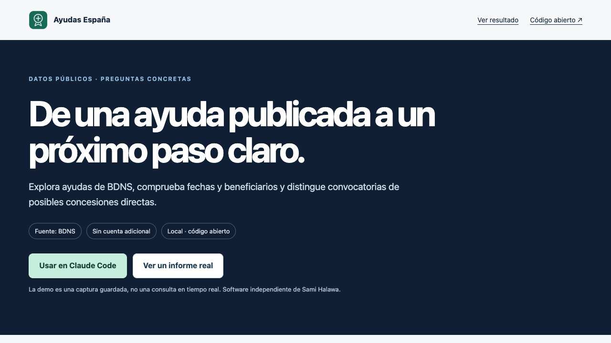

<p></p>

# Ayudas España

## De una ayuda publicada a un próximo paso claro.

Explora ayudas de BDNS, comprueba fechas y beneficiarios y distingue convocatorias de posibles concesiones directas.

**Para:** Autónomos, empresas y entidades que buscan financiación pública.

**Fuente:** BDNS · **Sin cuenta adicional ni API key** · **Python 3.11+** · **MIT**

### Qué obtienes

- Búsqueda y detalle de hasta cinco convocatorias por consulta.
- Plazos, beneficiarios y bases visibles en la misma ficha.
- Señales de concesión directa y fallos parciales explícitos.

### Pruébalo con una pregunta

> Soy autónomo en Madrid: busca ayudas de digitalización y dime qué debo comprobar.

También: “Compara estas convocatorias por plazo, beneficiarios, documentación y próximo paso.”

[Ver el informe de ejemplo](https://samihalawa.github.io/ayudas-espana/demo.html) · [Web y demostración](https://samihalawa.github.io/ayudas-espana/) · [Flujo completo](skills/ayudas-espana/references/workflow.md)

La demostración es una **captura guardada de fuentes oficiales**, no una consulta actual. Conserva fecha, enlaces y alcance.

[](https://samihalawa.github.io/ayudas-espana/)

## Instalar en Claude Code

```text
/plugin install ayudas-espana --marketplace samihalawa/ayudas-espana
```

O desde terminal:

```bash
claude plugin marketplace add samihalawa/ayudas-espana
claude plugin install ayudas-espana@ayudas-espana
```

Después, pregunta en lenguaje natural o invoca `/ayudas-espana:ayudas-espana`.

## Ver un resultado sin conexión

Desde una copia de este repositorio:

```bash
python3 skills/ayudas-espana/scripts/run.py demo
python3 skills/ayudas-espana/scripts/run.py demo --format html --output ejemplo.html
```

## Consultar y guardar un informe

```bash
python3 skills/ayudas-espana/scripts/run.py report ayudas_shortlist --json '{"query": "digitalización", "limit": 3}'
```

Añade `--format html --output informe.html` o `--format json`. No se sobrescriben archivos por defecto. `doctor` comprueba el entorno local sin consultar proveedores.

## Dónde funciona

| Entorno | Comportamiento |
|---|---|
| Claude Code / Codex con Python y red autorizada | Adaptadores e informes ejecutables. |
| ChatGPT con navegación/archivos | Flujo con herramientas nativas disponibles; no es un MCP alojado. |
| Sin red | Demo guardada o documentos aportados; no datos actuales inventados. |

## Alcance real

Hasta cinco detalles por llamada. Fechas, abierto y palabras como nominativa no sustituyen bases, modificaciones y sede. No presenta solicitudes ni garantiza financiación.

## Verificación

```bash
python3 -m unittest discover -s tests -v
python3 scripts/check_package.py
claude plugin validate --strict .claude-plugin/plugin.json
claude plugin validate --strict .
```

[Mejoras y crítica](CHANGELOG.md) · [Evidencia versionada](evidence/) · [Revisión de Claude](SUBMISSION.md). Los tests no equivalen a adopción. `ci/validate.yml` es una plantilla inactiva.

**English:** An independent workflow for Spanish official data, with a self-contained Python adapter, offline example and readable reports. Answer language follows the user.

**Sami Halawa** · Software independiente; sin afiliación oficial. [Privacidad](PRIVACY.md) · [Condiciones](TERMS.md) · [Soporte](SUPPORT.md) · [Seguridad](SECURITY.md).
